# FARMMARKET ERD

All tables, current + foundation (master spec Phases 1–2). Money and
quantities on the newer tables use `DECIMAL(12,2)`; the original marketplace
tables keep `Float` so existing behaviour is unchanged.

```mermaid
erDiagram
    USERS ||--o{ PRODUCTS : lists
    USERS ||--o{ DEMAND_REQUESTS : creates
    USERS ||--o{ ORDERS : buyer_or_farmer
    USERS ||--o{ NOTIFICATIONS : receives
    USERS ||--o{ FARMS : owns
    USERS ||--o{ OFFERS : buyer_or_farmer
    USERS ||--o{ VEHICLES : operates
    USERS ||--o{ REFRESH_TOKENS : holds
    USERS ||--o{ PASSWORD_RESET_TOKENS : requests
    USERS ||--o{ CONVERSATIONS : chats_in
    USERS ||--o{ AUDIT_LOGS : acted_by
    USERS ||--o{ GRADE_ASSESSMENTS : assessed_by
    USERS ||--o{ BATCHES : owns
    CATEGORIES ||--o{ PRODUCTS : classifies
    FARMS ||--o{ PRODUCTS : grows
    FARMS ||--o{ HARVESTS : yields
    CROPS ||--o{ CROP_LOCAL_NAMES : named_in
    CROPS ||--o{ HARVESTS : harvested_as
    COUNTRIES ||--o{ REGIONS : has_hubs
    PRODUCTS ||--o{ ORDERS : ordered_as
    PRODUCTS ||--o{ OFFERS : offered_on
    PRODUCTS ||--o{ LISTING_IMAGES : pictured_by
    PRODUCTS ||--o{ ORDER_ITEMS : line_item
    PRODUCTS ||--o{ PRICE_RECORDS : reference_product
    OFFERS ||--o{ ORDERS : accepted_as
    ORDERS ||--o{ ORDER_ITEMS : contains
    ORDERS ||--o{ BATCHES : linked_to
    CONVERSATIONS ||--o{ MESSAGES : contains
    BATCHES ||--o{ TWIN_DEVICES : monitored_by
    BATCHES ||--o{ SENSOR_READINGS : records
    BATCHES ||--o{ LEDGER_BLOCKS : sealed_in

    USERS {
      int id PK
      string name
      string email UK
      string password_hash
      string role "farmer|buyer|transporter|admin"
      string district
      string upazila
      string business_name
      boolean is_verified
      string country_code
    }
    COUNTRIES {
      string code PK "BD|KE|NG|GH|TZ|UG"
      string name
      string currency
      string default_hub_id
    }
    REGIONS {
      int id PK
      string country_code FK
      string hub_id UK
      string name
      float lat
      float lon
      string currency
    }
    FARMS {
      int id PK
      int farmer_id FK
      string name
      string district
      string upazila
      decimal area_acres
      string country_code
    }
    CROPS {
      string id PK "tomato|potato|..."
      string name
      string default_unit
    }
    CROP_LOCAL_NAMES {
      int id PK
      string crop_id FK
      string language "bn|en|sw"
      string name
    }
    HARVESTS {
      int id PK
      int farm_id FK
      string crop_id FK
      date harvested_on
      decimal quantity_kg
      string notes
    }
    CATEGORIES {
      int id PK
      string name
    }
    PRODUCTS {
      int id PK
      int farmer_id FK
      int category_id FK
      int farm_id FK
      string name
      float quantity
      string unit
      float price_per_unit
      string currency
      string district
      string status
    }
    LISTING_IMAGES {
      int id PK
      int product_id FK
      string filename
      string url
    }
    DEMAND_REQUESTS {
      int id PK
      int buyer_id FK
      string product_name
      float required_quantity
      float target_price
      string district
      date required_date
    }
    OFFERS {
      int id PK
      int product_id FK
      int buyer_id FK
      int farmer_id FK
      decimal quantity
      decimal offered_price
      string message
      string status "pending|accepted|rejected|cancelled"
    }
    ORDERS {
      int id PK
      int buyer_id FK
      int farmer_id FK
      int product_id FK
      int transporter_id FK
      int offer_id FK
      float quantity
      float unit_price
      float total_amount
      string status
      string delivery_status
      string proof_note
    }
    ORDER_ITEMS {
      int id PK
      int order_id FK
      int product_id FK
      decimal quantity
      decimal unit_price
    }
    VEHICLES {
      int id PK
      int transporter_id FK
      string vehicle_type
      decimal capacity_kg
      boolean refrigerated
      string plate_number
    }
    PRICE_RECORDS {
      int id PK
      string product_name
      string district
      float price_per_unit
      string source
      datetime recorded_at
    }
    PRICE_OBSERVATIONS {
      int id PK
      string hub_id
      string crop
      date observed_on
      float price
      string currency
      string source
      boolean is_synthetic
    }
    FORECAST_SNAPSHOTS {
      int id PK
      string hub_id
      string crop
      int horizon
      string fingerprint
      string payload
    }
    GRADE_ASSESSMENTS {
      int id PK
      int user_id FK
      int product_id FK
      string image_sha256
      string grade
      float confidence
    }
    NOTIFICATIONS {
      int id PK
      int user_id FK
      string title
      string message
      boolean is_read
    }
    REFRESH_TOKENS {
      int id PK
      int user_id FK
      string token_hash UK
      datetime expires_at
      boolean revoked
    }
    PASSWORD_RESET_TOKENS {
      int id PK
      int user_id FK
      string token_hash UK
      datetime expires_at
      boolean used
    }
    CONVERSATIONS {
      int id PK
      int user_id FK
      string title
      string language
    }
    MESSAGES {
      int id PK
      int conversation_id FK
      string role "user|assistant"
      string content
      string sources
      string mode
    }
    AUDIT_LOGS {
      int id PK
      int user_id FK
      string action
      string details
    }
    EXTERNAL_DATA_SOURCES {
      int id PK
      string name UK
      string kind
      string endpoint
      string countries
      datetime last_sync_at
      string status
    }
    BATCHES {
      int id PK
      string batch_code UK
      int farmer_id FK
      int order_id FK
      string crop
      float quantity_kg
    }
    TWIN_DEVICES {
      int id PK
      string device_id UK
      int batch_id FK
      string label
    }
    SENSOR_READINGS {
      int id PK
      int batch_id FK
      string device_id
      datetime recorded_at
      float temperature_c
      float moisture_pct
      string signature
      boolean sealed
    }
    LEDGER_BLOCKS {
      int id PK
      int batch_id FK
      int idx
      string event_type
      string payload
      string prev_hash
      string block_hash
    }
```

Notes:

- The current MVP computes matches on demand from `products` and
  `demand_requests`; it does not persist match rows. The `Category` table is
  prepared for future categorization.
- `offers.farmer_id` is denormalized (it duplicates the product's farmer) so
  a farmer can list offers on their products without joining `products`.
- `orders.offer_id` is set only for orders created by accepting an offer;
  direct purchases leave it NULL. `order_items` is reserved for future
  multi-item orders; the single-item order flow uses `orders.product_id`.
- Refresh and password-reset tokens are stored only as SHA-256 hashes.
- Schema changes for real deployments go through Alembic
  (`backend/alembic/`); `Base.metadata.create_all` in `app/main.py` is kept
  for tests and the quick SQLite demo only.
